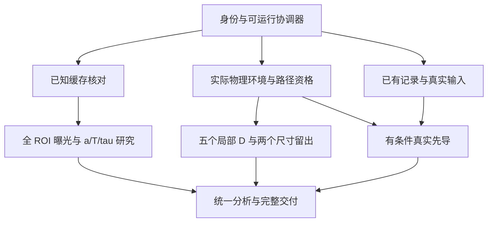

# 反射式 iSCAT 磁纳米颗粒测径：V120 审查与 V121 连续仿真执行合同

**审查日期：2026-10-20 UTC / 2026-10-19 PDT。** 首次取证 2026-10-20 04:28:49 UTC；交付前于 **2026-10-20 04:42:33 UTC** 再次核对，`v120` 仍指向下列固定提交，未变化。

**固定对象：**`yyyyzoey/iscat-handoff`，V120 提交 `2bdb53a4b1f79a012d3e55be0eb1139fce78956b`。

**裁决：V120 有真实的新缓存入口代码，但当前发布不满足“100μs有限曝光、41×41探测像元完整ROI、原同数组谱门”的执行合同。** 新入口实际定义的是中心41×41细采样图块的瞬时强度计算；新命名算子仍为旧字节，且没有被入口调用。未取得本轮实际数组、命令、账本和原ZIP，不能认证提交说明中的运行/修复/绿色验收范围，也不能断言原工作站没有运行或没有这些文件。

**计数要点：V120的实际BEM/render/完整观测尝试数尚未独立核实。** 根目录status仍为V119旧字节，不能将其中0/16、0/216、0/64当作V120实耗。当前可以确认的是：没有交付可验收的本轮完整探测ROI有限曝光结果。

**下一批任务：`V121_CORRECT_DETECTOR_EXPOSURE_AND_CONTINUOUS_LOCAL_RESPONSE`。** 修正真实科研调用路径后，同批完成缓存全ROI、a/T/tau灵敏度和误差分析；物理路径合格就自动接续五D、zf扰动、两个预注册尺寸留出；真实条件成立再接最多两个先导。首个正确中央观测不是本批停止点。

**本次实际审查工作：**固定提交/父链/全部文件增量比对、关键源码原字节校验、实际代码调用/参数使用检查、单个非对称合成空间帧与纯函数小夹具、已有合同的数学和预算交叉校验。没有执行新BEM、render、实际缓存完整时序、原实验图像提取或旧大套件。下文V121计算均为待执行合同，未用方案冒充结果。

---

## 第一部分：V120 的证据与裁决

### 1. 固定发布身份：新增四份代码，状态和结果证据没有同步

| 项目 | 固定证据 |
|---|---|
| V120提交 | `2bdb53a4b1f79a012d3e55be0eb1139fce78956b` |
| 提交时刻 | 2026-10-20 04:25:06 UTC |
| 实际Git tree | `0e6d79b187598edccafbb938ecc42fd7d2ac8fc4`，1092项，未截断 |
| 直接父提交 | 已审V119 `1b449d86e44f8ebe8a3444ada80c27819b9b3fbd` |
| 更早父链 | V119 → V118部分元数据增量 `974c64ec…` → V117 `bbd03877…` |
| 相对V119的文件变化 | 1个提交；4 added、0 modified、0 removed |
| 当前status/review | 与V119同blob，仍为V119任务与正文 |
| 当前来源/清单 | source_identity、execution_code_manifest、manifest_sha256均与V119同blob |
| 本轮合同副本 | 固定树未收录完整V120合同；提交任务名对应上一轮要求，但不能认证全文逐字节接收 |

来源：[提交][r-commit]、[固定比较][r-compare]、[status][r-status]、[review][r-review]。

四个新增文件实际是：

| 文件 | 字节数 | 实际内容 |
|---|---:|---|
| `tools/_fix.py` | 455 | 修改缓存runner的相对路径层级 |
| `tools/_fix2.py` | 790 | 修改MATLAB compound complex数据的读取方式 |
| `tools/observation_operator_v120.py` | 26,611 | 与V119算子同字节的副本 |
| `tools/run_v120_cache_observation.py` | 4,571 | 独立读取缓存、瞬时细采样图块、单路DFT脚本 |

V120提交信息声称已生成D100/zf450完整ROI缓存观测、修复算子且测试为绿。提交文字属于报告声明；代码、实际执行身份、返回数组和验收证据分别审查，不能互相替代。

### 2. 最重要的模型偏差：曝光与探测像元定义没有实现

#### 2.1 曝光参数声明了，但没有参与计算

新runner第91行设 `T_exp=100e-6`；AST检查显示它在整个文件的读取次数为0。第93–103行只在 `t_j=j/Fs` 取一次位置、插值场、求强度。没有曝光窗口、求积节点或解析积分。

因此，该实现的每帧观测是

\[
I^{\mathrm{V120}}_j=I(x(t_j)),
\]

合同所需的是中心标时的

\[
\overline I_j(T)=\frac1T\int_{t_j-T/2}^{t_j+T/2}I(x(t))\,dt.
\]

二者仅在特定条件或极限下相等。把T写入变量或说明不能提供有限曝光。当前不能量化它对项目粒径估计的实际影响，因为本轮实际数组尚未取得。[新runner][r-driver]

连续单谐波的100μs示例：H(200)=0.9993421562398412、H(400)=0.9973701827725034、H(800)=0.9895056209813083。该例说明曝光一般有效应，不等于对项目有限窗口归一化C的直接比例修正；不能只除一个sinc修补旧结果。[已有解析表][r-sinc]

#### 2.2 41×41数组是细采样点，不是41×41探测像元

已有源约定：h5py场为 `(pol, MATLAB column, MATLAB row)`，形状 `(3,325,325)`；正确探测ROI是物理像元13:53，对应MATLAB fine 61:265，即Python `60:265` 的205×205细网格。每个探测像元使用5×5=25个细采样强度点。[原轴与ROI定义][r-cachecode]

V120第97–103行使用中心162、半宽20，直接截取Python `142:183`，即MATLAB fine 143:183的41×41点，并未进行5×5强度归约。它还保留h5py的列/行次序，没有转成约定的探测像元(row,col)。

| 比较项 | V120实际代码 | 合同要求 |
|---|---|---|
| 输入空间范围 | 中心41×41 fine点 | 完整205×205 fine点 |
| 每个输出像元 | 一个fine点的强度 | 25个fine点的加权强度平均 |
| 输出尺寸 | 41×41 | 41×41 |
| 轴语义 | h5py column/row | 明确MATLAB row/col与新pixel_id |

**相同shape无法证明物理ROI正确。** 本次用一个非对称坐标编码的合成空间帧做小型核对，V120裁剪和正确探测平均都输出41×41，但首元素分别为143143与63063；线性夹具的中心可以恰好相同。另一个含空间曲率的合成场，中心点3175524与正确像元平均3175726也不同。这些数字仅为软件夹具，没有作为真实强度或新仿真结果。

不能放大、插值或重命名这个41×41旧图块来补齐缺失空间范围与曝光。应从原五复场重新生成正确观测；原产物若取得，保留原定义作为历史原型证据。

### 3. 算子修复与谱验收没有接入真实科研路径

#### 3.1 新文件名不是新修复字节

`tools/observation_operator_v120.py`：

- Git blob：`dc6288c41af336f2fc17226661bfa87f99d14c4b`。
- SHA-256：`4234b1cd7e172e7a2cffd29ac1ff99656afd3ca8cdaed98ef7bf4f5647c8b2fc`。

它与已审V119算子精确相同。上一轮发现的标量负值绕过、NumPy complex64静默丢虚部、实标量规范化不贯通、公开g/b类型和回归异常分类缺口，没有在这份发布字节中修复。上轮两帧探针仍限定原Python 3.12.14 / NumPy 2.3.5；本轮没有重复同blob测试凑新进展。[发布算子][r-operator]

新runner根本不导入此文件，也不调用其run_roi或FFT/DFT验收。即便另一目录的某个模块有绿色套件，也不能认证这个新入口。

#### 3.2 DFT公式可保留，验收门没有执行

第107–114行的负号DFT及 `C=2X/(N*Imean)` 在合法输入上有数学依据；总场先相加再平方也正确地包含干涉与纯散射项。这些局部正确实现应保留。

但实际只有 `np.exp + einsum` 一条DFT路径：没有numpy.fft与独立整数余数相位/math.fsum的双路核对，没有均值门、固定mask、均值正域或全数组finite检查。`GATE_XC/GATE_MEAN`均声明后未使用。`SUCCEEDED`只是执行到那一行时写入的字符串，不能当作数值通过。

**准确结论是门未实施，不是实际浮点残差必然超限。** 未取得实际数组，不能编造残差、稳定性或尺寸性能。[新runner][r-driver]

#### 3.3 其他需要处理且应限定影响的实现问题

| 代码事实 | 影响范围 |
|---|---|
| 循环反复覆盖Eref，最后取x=+20文件 | 没有五份参考场一致性核对；不能反向断言它们实际不同 |
| 插值域外返回端点，main又clip | 当前a=10及本批a=9..11均不越±20；后续轨迹若越界，会被静默端点替代；NaN在纯函数夹具中也返回最后端点 |
| `--root`必填但转换后未使用 | 缓存位置仍按脚本层级推定，不能保证在另一工作根读取正确输入 |
| TASK_ID、EXPECTED提交和SHA helper未用 | 当前来源/配置门没有实际运行 |
| 未使用blob helper把NUL写成字面反斜线序列 | 接入身份链前须修；当前未调用，不能说已经污染数值结果 |
| 异常无finally保存阶段结果 | 缓存读取/数组失败可能直接结束，前序工作不能可靠交付 |

两个fixer只修改runner路径与compound读取；前者零替换也打印fixed，后者对已经修好的源码重跑会断言失败。保留历史记录，下一轮不再把它们加入自动执行流程。[路径fixer][r-fix]、[读取fixer][r-fix2]

### 4. 结果、运行次数和归档的证据边界

新runner计划在实际 `--out` 下输出：

- `cached_observation_D100_zf450.npz`：roi_series、Imean、C_80/160/320。
- `v120_results.json`：阶段字符串、shape、bins、elapsed和scope。

固定发布树没有这两个结果，也没有实际命令、stdout/stderr/返回码、当前账本、cache_eligibility、物理输入或外部终验。已检查的返回包搜索未取得本轮原ZIP，GitHub releases入口返回空列表。这里的未取得仅限定本次访问的交付证据，不推断原工作站不存在这些文件。

NPZ设计未单独保存X，但有效完整时序如果后来取得，X可以重算；真正缺失的是当前数组本身和运行/参数/来源对应。不能把“没直接存X”夸大成绝对无法重放。

| 状态维度 | 本次应记录 |
|---|---|
| 版本增量 | `V120_CODE_DELTA_OBTAINED` |
| 实际实现范围 | `INSTANTANEOUS_FINE_GRID_CROP_PROTOTYPE` |
| 本轮实际调用计数 | `V120_ACTUAL_CALL_COUNTS_UNVERIFIED` |
| 正确完整ROI有限曝光结果 | `NOT_DELIVERED_NOT_CERTIFIED` |
| 发布算子修复 | `FIX_NOT_PRESENT_IN_RELEASED_BYTES` |
| 后续扰动、五D、留出、真实先导 | 未取得本轮完成证据 |
| 连续合同 | `CONTINUOUS_CONTRACT_NOT_COMPLETED` |
| 原ZIP | `ORIGINAL_V120_ARCHIVE_NOT_OBTAINED` |

status里的V119旧0次、旧桥接/元数据认证声明不能改写成V120当前证据。历史576在其真实依赖不变的范围仍可继承；新科研路径需要自己的资格，不能借旧绿表通过。[旧status][r-status]、[桥接继承记录][r-inherit]

### 5. 下一轮不再停在一个中央点：先把正确观测接通，再完成整组研究

V121首要改变是让实际调用关系与科学声明一致。当前入口已经指向具体原工程缓存，下一轮先取得实际输出根/命令和五文件身份，随后直接使用正确物理像元归约、曝光积分、谱门和当前来源记录。

已知缓存根为：

```text
C:\Users\PC\Documents\Codex\2026-09-20\https-chatgpt-com-share-6aafd462-6e70\work\iscat_v0_4\v074_return\numeric\render_cache
```

五个历史D100/zf450缓存有明确记录，合计16,604,403 B；第10节给出逐文件身份。上一轮完整合同已经提供正确像元重排、系数/曝光矩、导数、五D与留出设计；本合同保留这些科学定义，并加强真实入口和当轮交付要求。[缓存身份][r-cacheids]

元数据也不应重新停在文件名：先完整读取216B的video_param.json，再读取已有轨迹和帧检测结果的必要字段；`metadata_inventory_v118.csv`在V120没有变化，不能称本轮已补齐真实输入。[元数据库存][r-metadata]

本批最先保护的结果是：**正确全ROI基准生产/独立参考2次，加a/T/tau十二个差分观测，共14次缓存核心观测，并完成导数和误差解释。** 缓存成立时它们不依赖新BEM。新物理路径成立再接完整局部尺寸和留出计划；计算预算统一，缺一项只阻断实际依赖分支。

---

## 第二部分：交给 Codex 的唯一 V121 连续执行合同


### 6. 本轮任务、能力分支与持续执行规则

任务 ID 固定为 **`V121_CORRECT_DETECTOR_EXPOSURE_AND_CONTINUOUS_LOCAL_RESPONSE`**，schema 为 `iscat121.status.1`。起点是本次已审 V120 固定提交。不要覆写 V120 的历史状态或把其未完成项倒填为完成。

本轮研究问题保持为：在明确条件下，100 nm 附近尺寸变化能否与运动振幅、焦面、曝光和相对同步区分；现有数据与误差允许什么结论，需要哪些独立约束。

能力分别登记，不使用所有历史门总绿作为共同入口：

| 能力 | 实际需要的证据 | 缺失时主要影响 |
|---|---|---|
| Python 数组分析 | 实际解释器/依赖/算子身份及有限资格 | 对应分析路径 |
| 既有记录读取 | 实际文件原值、SHA、采集对应关系 | 真实输入判定和已有观测分析 |
| 合格缓存/系数包读取 | 源字节、cfg、轴、支持域与模型资格 | 缓存全 ROI 分支 |
| MATLAB 可执行 | 实际可执行文件、版本、调用返回码 | 需要 MATLAB 的操作 |
| 实际 NANOBEM/项目路径 | 真实导入、补丁、光学约定、P0适用范围 | 新系统求解及依赖它的新场 |
| 真实装置输入/尺寸参考 | 实际量尺、光路、曝光/同步、运动、样品与验证证据 | 相应真实前向/计数/尺寸验证 |

每个 scope 的入口由来源、模型、实际算子、数值路径、预算和本合同范围共同派生。归档是否完成不是科学路径入口。缺第五项不能自动阻断第三项；缺 κ/g 不自动阻断理想 C；条件模型不将真实缺项改成已测量。

执行关系：



同一批次持续到全部可运行阶段完成、明确阻断或资源到限。不能在阶段小结后自动结束等待下一条指令。真实输入已齐备时优先真实分支；否则缓存研究与环境恢复按资源独立推进。

### 7. S0：冻结身份，建立并实际运行完整协调器

1. 读取本次 V120 固定提交及实际工作根。若启动时有晚到 V120 材料，先作一次固定增量核查；冻结之后不热切换执行代码。
2. 分别记录V120 release `2bdb53a4…`、真实直接父V119 `1b449d86…`、更早V118部分增量 `974c64ec…`、科学继承基线V117 `bbd03877…`、实际运行HEAD、源外execution_root和output_root。原工作站历史执行身份与本轮身份分开。
3. 在源外建立真正完整的 `run_v121_all.py`、实际缓存/曝光/谱分析helper和 `v121_archive_check.py`。保留V120可用的有符号loader和总场强度关系，按本合同修正空间、时间及来源。新入口必须有全部阶段实现、显式导入、资源预算器和checker；不能只复制一个未调用的算子文件或将旧脚本更名。
4. launch 在阶段工作之前落盘，记录完整命令、UTC起点、环境、实际 `__file__`、源码 SHA、输入和预期输出。开始/结束 HEAD、clean 与 Git 返回码实际参与来源资格；不能把空stdout当成功。
5. 新结果保存当前 manifest；旧身份和旧表放入 inherited 范围，不能复用旧 manifest 给新成员作认证。

启动时先定向取得V120实际 `--out`、NPZ/JSON、命令、stdout/stderr、返回码及当时运行源码SHA。取得则原样保存、检查key/shape/finite和来源，并按实际“瞬时fine图块”定义登记；未取得则保留具体缺失，不为补历史证据重跑V120错对象。读取已有数组不算新生成观测；任何新重现/瞬时对照都计入第16节预算。

`--project-root`、`--cache-dir`、`--execution-root`、`--out`、`--contract`和预算文件均须真实生效。解析后记录实际绝对路径并验证对应关系；显式缓存目录决定读取位置，不依赖脚本恰好处于某个相对层级。接收的完整合同作为输入保存，launch计算其真实SHA；不把合同自己的哈希写回自身造成循环。修复/删除未使用的错误blob helper，必要Git blob header使用实际NUL。

软件检查预列为最多10组：

| 组 | 必须覆盖的实际风险 |
|---|---|
| 1 | 启动路径、实际模块 `__file__`/SHA与有效配置；缺root/cache拒绝或范围阻断 |
| 2 | 严格实强度入口的scalar/NumPy complex/finite/负值及多像元正例 |
| 3 | 非对称坐标和空间曲率单帧：轴、205×205范围、每像元25点，不能只测中心或shape |
| 4 | 真正曝光入口的小谐波夹具：改变T得到解析预期的复响应；中心矩形单谐波检查sinc幅度及正确相位，显式瞬时极限与恒定强度分别检验 |
| 5 | 原场→强度→空间平均与系数路径的确定位置核对；实际源数据另在S3执行 |
| 6 | 源场形状/complex格式、参考场不一致、乱序/重复锚点、越界/NaN支持域拒绝 |
| 7 | 实际谱比较器的X/C/均值门、非法均值及强制谱错误拒绝，不能仅检查常量存在 |
| 8 | 本轮需用的κ/g/b静态规范化、异常类型和逐项计数，旧tuple短路不能蒙混通过 |
| 9 | 缓存与MATLAB能力独立、失败传播、预算预扣、时限与前序结果可靠落盘 |
| 10 | 当前归档checker正例及缺必要成员/错误身份拒绝，科学状态与包完整性分开 |

以上是组上限，不扩成大量交叉组合。夹具明确标记TEST，不当项目科研结果。各修复最多两轮，第二轮仅重跑相关失败；该scope资格一旦成立立即继续科研，不能等所有无关公开入口修完。两轮后保留OPEN_WITH_SCOPE，继续无该依赖的工作，不再用旧run_v117_all全套绿表代替新研究。

**真正的默认主流程：S0后并行推进相关S1修复/资格、S2记录读取和S3缓存准备；相关数值路径与缓存资格成立后S4→S5；物理路径资格成立后自动接续S6/S7/S8；最后统一交付。** MATLAB缺失不阻断合格缓存路径，S1实际数值资格也不能省略。调试时可有单阶段入口，但合同完成不能由它派生。每个阶段输出实际数值和资格字段后才能登记完成，首个中央NPZ产生不得触发整批退出。

### 8. S1：恢复实际环境并修最小算子边界

#### 8.1 环境恢复在同一批完成，不把 PATH 问题写成物理失败

明确当前是原 Windows 工作站、另一 worktree，还是只能访问 Python 的隔离上下文。先查已有明确项目根、命令路径和依赖配置；实际核对 MATLAB 可执行文件、版本和返回码，`prepare_nanobem`、`build_system`、`render_system` 的实际解析路径与所有同名候选。不要盲目运行会自动下载或改路径的旧 helper，先读其行为。

若是明确的路径问题，恢复源外执行环境的路径即可；若固定开源源码缺失但实际 MATLAB 可用，可在独立依赖目录恢复指定上游 `ce49f77f096337db8be54c46d83696d37b0b23d5` 及已经识别的项目补丁，记录来源。安装/路径恢复本身不等于物理模型合格，后续仍核符号链与P0。不得替换历史依赖或改写旧结果来配合新环境。

环境定位最多两轮定向恢复。查不到时保存实际根、命令、错误与范围；不能声称原工作站没有某软件。当前上下文不能读取原文件时，不假装完成文件传输；若原工作站可操作，在那里导出第10节便携包，再在可用Python上下文接续。客观缺访问能力时保留具体动作与未执行范围，其他可行工作继续。

#### 8.2 与本轮实际强度路径有关的修复

- 标量先规范为合法二维表示，再统一验值，不能提前返回绕过负值/复数检查。
- 对 callback 的原始 dtype/元素类型，在任何实数强转之前拒绝 Python complex、NumPy complex64/complex128、非数字对象及不符合合同的布尔值。不得用 ComplexWarning 代替拒绝。
- 静态参数的规范化返回值实际传到下游；Python/NumPy 实标量和向量规则一致；静态非法参数0回调。
- 公开计数 helper 同样验型、finite、定义域；测试 helper 只接受明确预期异常，裸 TypeError 失败；原 tuple 子调用逐项捕获、逐项计数。
- callback 动态异常在第一次可知位置稳定包装并保留cause。源场、强度、mean及X全数组必须finite；强度、电子期望及本合同非负DN时序另查非负性，归一化均值另查正域。C/dC只在明确有效的归一化域检查finite，mask外按第11.4节NA约定存储；c1及合法参数导数可带符号或复数，不能施加统一非负门。像元轴始终保留。

以第3节已知失败范围和第7节有限夹具做定向红绿检查。新适配器可以限定只接受严格float64实强度矩阵/向量，明确命名和实际使用范围；必须被真实科研入口调用并在结果中记录模块身份。不能通过另一个未被调用的副本认证它，也不能把未修完的其他公开入口改成全绿。

原同数组 X/C `<1e-11`、mean `<1e-12` 门不放宽；原来源 C 恒等式 `<1e-10` 是另一门。历史576只继承；新完整时序通过自身同数组FFT/独立DFT和均值必要门。

### 9. S2：读已经找到的文件，形成真实外部输入

优先完整读取库存中的216字节 `video_param.json`，其已知路径为 `C:\Users\PC\Desktop\课题\7.29\7.29\BMP100053022-20260729-105610\video_param.json`。随后读取既有粒子轨迹、帧检测和对比度结果的schema、必要列和实际窗口。允许读取既有提取结果、元数据与模型缓存；原BMP/视频读取与重新提取仍为0。

生成完整 `metadata_search_inventory.csv`，对声明的24项与实际11个hit逐项补足或解释筛选；输出 `physical_evidence_index.csv`、真正外部的 `physical_inputs.json`、正式语义结果及剩余取证动作。

每个字段有：实际证据位置/SHA、原值、单位、设备模式/采集/窗口、来源等级、定义域和不确定度。USER_CONFIRMED、SCRIPT_RECORDED、NOMINAL_LABEL、MEASURED、LITERATURE、ASSUMPTION、MISSING、CONFLICTING 分开。配置值是配置记录，不自动升级为仪器校准。关键词和文件名不能代替字段解释。

实际validator检查单位/finite/定义域、重复ID、缺失与值冲突、采集适用性、run_effective、证据对应、边界及N/A理由。schema可有效而真实输入不齐；不得硬编码 `METADATA_SCHEMA_VALID=true`。

轨迹路线A必须有量尺、帧/共同时间、坐标/方向、跟踪误差和适用窗口；像素轨迹不等于nm位移。路线B须有足够磁场与力学约束。共同条件 AND (A OR B)，不强迫两路线同时满足。

520nm用户确认保留；标称100nm不是每粒子独立真值；Fs=5000脚本常数不是时钟校准；演示65nm/px、旧推算56nm/px及另一数据集60fps不能互填。电子期望需强度前向及κ/单位/曝光闭合，DN再加g/b与范围；真实DN归一化C仍要处理偏置、线性和饱和。缺κ/g本身不阻断合格理想C研究。

已有D文件名含absolute不能作独立参考；开发窗口和留出窗口分别登记。无独立留出时可做诚实的固定前向对照，不能称留出验证。

### 10. S3：实际读取五锚点，导出可移植的逐像元场模型

这是本轮优先落实的数值入口。先查第5节缓存目录下的五个文件，逐个核对当前字节数/SHA、实际D/zf/dx字段、Es/Eref的dtype/形状/finite、坐标和生成来源。正负位置键必须不同；不得使用旧 `makeValidName` 碰撞后的结构体代替有符号原文件。

| 文件 | 历史字节数 | 历史SHA-256 |
|---|---:|---|
| `D100_zf450_x-20.mat` | 3,321,048 | `e54f730659df4c77e5600d3f239a6ed36f0b996c693dd08514b87f30d087ba30` |
| `D100_zf450_x-10.mat` | 3,321,675 | `9eedbbee501d135a8e2de02f31380fb92a1d69bcc8c8809c1a4cf81f9ce33db8` |
| `D100_zf450_x+0.mat` | 3,318,697 | `ef8863555448e9264180b8aa086125ab3172d9ca4dd91942f188ec6b1e7d197d` |
| `D100_zf450_x+10.mat` | 3,321,523 | `839949385412b8c59195f0b4a27fb46a1313f6b2998269470c53b9661c860f32` |
| `D100_zf450_x+20.mat` | 3,321,460 | `c05471df9a9d2e3101c3ea1d6212ee38e4df831586121b49db0434c36bac87f0` |

这些是历史记录，不是本次已读回原件的声明；合计16,604,403 B。实际读取支持已确认的MATLAB compound real/imag格式；若遇其他dtype，先按实际格式资格处理，不把任意对象默默转实数。缺scipy等未使用导入不能成为缓存研究的人为阻断；只保留实际使用的依赖。

分别记录 `CACHE_NUMERIC_READY` 与 `CACHE_PHYSICS_VALIDATED`。可追溯原字节和明确插值规则足以定义一个条件数值场模型；物理配置或P0未完整验证时，不认证其真实物理准确性，不据标签推断缺失参数。新D场复用与真实前向仍要求完整匹配配置，不能把数值缓存资格直接用于它们。

#### 10.1 轴、像元与子采样

原 h5py 场为 `(pol, MATLAB column, MATLAB row)`，完整ROI fine范围为 MATLAB `61:265`。`v083_common.roi_blocks` 输出 Es 是 `(anchor,h5col,h5row,pol)`。

规范输出使用 MATLAB 的 `(row,col)` 坐标，但**另行定义行优先** `pixel_id0=row0*41+col0`；这不是 MATLAB 原生线性索引。以下 `Es_h5/Eref_h5` 特指roi_blocks输出，完整操作为：

```python
Es = (
    Es_h5.transpose(0, 2, 1, 3)
    .reshape(5, 41, 5, 41, 5, 3)
    .transpose(0, 1, 3, 2, 4, 5)
    .reshape(5, 1681, 25, 3)
)
Eref = (
    Eref_h5.transpose(1, 0, 2)
    .reshape(41, 5, 41, 5, 3)
    .transpose(0, 2, 1, 3, 4)
    .reshape(1681, 25, 3)
)
```

其中 `subpixel_id0=subrow0*5+subcol0`。中间将两个探测像元轴放在一起的transpose不可省略；仅转成fine_row/fine_col后直接reshape为(P,Q)会混组。

P=1681 是探测像元数；Q=25 是每像元原5×5子采样。权重必须采用原模型的实际空间规则并归一，不能把侧长5当总点数25，也不能汇聚不同P。

必须逐锚点核对 Eref 一致性；不能只取第一份后默认其他相同。若不一致，报告差异和来源，不能悄悄改变参考场模型使之通过。

#### 10.2 精确归约为四段、逐像元三个系数

在区间 `[x_s,x_{s+1}]` 内，令

\[
B_{s,p,q}=\frac{E_{s+1,p,q}-E_{s,p,q}}{x_{s+1}-x_s},\qquad
A_{s,p,q}=E_{\mathrm{ref},p,q}+E_{s,p,q}-B_{s,p,q}x_s.
\]

按同一探测像元的归一空间权重计算

\[
c_{s,p,0}=\sum_q w_{p,q}\|A_{s,p,q}\|^2,
\quad
c_{s,p,1}=2\operatorname{Re}\sum_q w_{p,q}A_{s,p,q}^{*}\!\cdot B_{s,p,q},
\quad
c_{s,p,2}=\sum_q w_{p,q}\|B_{s,p,q}\|^2.
\]

于是

\[
I_p(x)=c_{s,p,0}+c_{s,p,1}x+c_{s,p,2}x^2.
\]

这是完整总强度、包含纯散射项的归约，等价于先求强度再做像元内积分。它不等价于先平均复场再平方。

输出 `x_knots_nm[5]` 与 `coeff[4,1681,3]`（float64）。系数数组有效载荷为 **161,376 B**，另加元数据和文件格式开销；不是整个包必定只有这个大小。记录原五文件实际SHA、配置已知/未知项、单位、参考场、ROI/像元映射、权重、生成代码和计算顺序。

用五个锚点和四个区间中点的确定位置，核对原场直接插值→总强度→像元平均与系数结果；这是同一插值模型的代数一致性检查，不是新render或真实电磁插值误差验证。至少覆盖完整像元映射及中心/边缘/正负位置关系，保存逐项最大差与原因，不用自身两次计算作假独立对照。

若采用P=1681、Q=1的“空间积分已完成”入口，要明确Q=25在系数生成时归约，并证明与实际(P,25)路径一致；绝不合并P轴。

**包的适用范围固定：**它只保留该D、zf、材料、几何、参考场和x向场映射的强度模型。不能从单D包得到局部D导数；不能自由改变参考场相位、材料、高度、取向或轨迹方向。它也不能重建被归约掉的完整复场。

原五文件合计仅约16.6MB，能取得时一并保存便携原件及配置/来源；若交付只包含系数包，明确标记其可重放的是该强度模型。原文件无法取得时，不用合成余弦fixture冒充本阶段已完成。

### 11. S4：完整 ROI 有限曝光，采用可核对的矢量化计算

缺真实配置时，本阶段明确采用条件设计：D100/zf450缓存，`x(t)=10 nm*cos(2*pi*200 Hz*t)`，y固定；T0=100μs、中心标时；N=2001、Fs=5000Hz。这些是条件假设，不是实测轨迹、曝光或量尺。

分析主通道仍是约400Hz。零基k={80,160,320}的实际频率约为{199.900049975,399.800099950,799.600199900}Hz；MATLAB数组索引对应{k+1}。不把规定运动200Hz、目标谐波400Hz、有限DFT频率混成一个数。

#### 11.1 先验证支持域，再积分；不允许静默clip

完整轨迹及每帧曝光窗所需x都必须在[-20,20]nm支持域。原 `lin_weights` 会静默clip；新适配器必须先拒绝域外轨迹，并记录越界值/时刻。端点插值索引的合法处理可以保留，但不能修改物理位置来“满足”边界。

空间区间采用唯一归属规则，内部半开、最后端点闭合，避免节点在锚点处重复计权。切触、重复切点、a=0、omega=0均有明确处理。正常研究T>0；显式瞬时对照若采用T=0，使用独立极限分支，不套除T公式。

#### 11.2 生产路径：12个曝光矩，再保留全部像元输出

不用把每个候选都展开成N×P×Q×求积节点的Python循环。对帧j、空间段s、阶数ell=0,1,2，计算

\[
M_{j,s,\ell}^{\mathrm{prod}}
=\sum_q \widetilde w_q\,\mathbf 1_s(x(t_{j,q}))\,x(t_{j,q})^{\ell},
\qquad \sum_q\widetilde w_q=1,
\]

其中q在此式是**曝光求积节点**，不是像元子采样Q；实现变量名应明确区分。然后

\[
I_{j,p}^{\mathrm{prod}}=\sum_{s=0}^{3}\sum_{\ell=0}^{2}
M_{j,s,\ell}^{\mathrm{prod}}c_{s,p,\ell}.
\]

可用 `einsum('jsl,spl->jp', M, coeff)` 或等价的受控矩阵运算，按时间分块，输出始终为完整(N,P)。新的实际适配器必须单独命名、保留代码身份和资格；不把其通过解释为旧callback路径全部修复。

V121生产路径优先在全部锚点穿越处分割曝光窗，对每个平滑子窗使用16点Gauss求积。若标准节点为xi_i∈[-1,1]、标准权重w_i之和为2，对子窗长度Delta、中心m，使用 `t_i=m+Delta*xi_i/2`、`wtilde_i=Delta*w_i/(2*T)`。若先将子窗权重归一成和为1，才直接再乘Delta/T；不能漏掉标准Gauss权重的1/2。

上式节点集合因此可以包含多个子窗，总归一权重仍为1。这样避免在分段模型的折点上盲目提高整窗节点数。切点由实际x(t)和锚点决定，需验证窗内覆盖、不重叠及中点归属；生产和解析参考若共用切点工具，明确这部分不是独立证据，另由小型穿越/切触/边界夹具核对。

确有误差需要才到每子窗32、64点；每次完整评估都计入64次总预算。不对每个工况默认三档全跑，也不因子窗数改变而把一次完整ROI输出拆成多个虚假研究工况。

#### 11.3 独立参考：全部锚点穿越处分段解析

对 `x(t)=xc+a*cos(omega*t+phi)`，求曝光窗内所有锚点穿越时刻，排序去重后逐段积分。令某段长度为Delta、中心为tm、theta_m=omega*tm+phi，定义 `sinc_u(u)=sin(u)/u`，u=0取1。

每段对未除整窗T的三个矩，稳定公式为

\[
J_0=\Delta,
\]
\[
J_1=\Delta\left[x_c+a\,\operatorname{sinc}_u(\omega\Delta/2)\cos\theta_m\right],
\]
\[
J_2=\Delta\left[x_c^2+\frac{a^2}{2}
+2x_ca\,\operatorname{sinc}_u(\omega\Delta/2)\cos\theta_m
+\frac{a^2}{2}\operatorname{sinc}_u(\omega\Delta)\cos(2\theta_m)\right].
\]

将各子段按所属空间段累计并除整窗T，得到独立的 `M_ref[j,s,ell]`，再生成全ROI参考。NumPy sinc 使用归一化定义，若调用它，传参需除π。不能跨锚点仍使用一组系数，不能仅相减极接近的原函数值作为极短曝光唯一实现。

该参考对既定分段线性复场模型的曝光积分解析，不是连续Maxwell真解。生产与参考共用场系数，因此场→系数的错误必须靠第10节原场对照独立检查，不能声称曝光对照覆盖所有误差。

生产与独立参考保存全数组绝对差、相对强度差及每像元每bin的复C差。本批预注册曝光数值资格为：`max_abs(Iprod-Iref)/max_abs(Iref) <= 1e-10`（参考全数组尺度必须正且finite），以及固定有效mask内 `max_abs(Cprod-Cref) <= 1e-10`。这是本批对两种曝光积分的工程容差，不是原同数组FFT/DFT门，也不是物理精度保证。弱像元仍由固定均值合法域和逐像元C差保护；局部D研究还需第13节目标扰动尺度上的误差检查。若两轮相关实现修正/允许加密后仍不满足，保留实际差并限定未通过的数值路径，不放宽阈值或改变mask凑通过。

真实非余弦轨迹必须按照实际轨迹表示建立独立积分参考，不能直接套本式。细参考与尺寸留出若满足余弦假设，可直接用解析曝光，减少无必要加密。

#### 11.4 固定观测定义、mask与同数组验收

\[
\bar I_p=\frac1N\sum_jI_{j,p},\qquad
X_{p,k}=\sum_j(I_{j,p}-\bar I_p)e^{-2\pi i kj/N},\qquad
C_{p,k}=\frac{2X_{p,k}}{N\bar I_p}.
\]

每个新实际时序独立执行生产FFT与同数组整数余数相位/math.fsum DFT；保留X/C全复数及mean原门，不仅比较幅值。弱信号使用绝对复残差，不能仅比较相位。

mask规则在读取候选或留出响应之前固定；若继承实际来源规则，记录其原式和身份。若来源没有适用于新观测的规则，本批从本分支固定D100基准的生产场、独立解析曝光均值生成M0：先取finite且正的基准均值集合，其median必须存在且为正，M0为均值正且严格大于该median的1%的像元；标为 `ANALYSIS_CONTRACT`，不称与旧BANK mask已经一致。

缓存与新物理cfg不同时，为新分支先冻结其自身D100基准mask，不能默认沿用旧缓存M0。真实先导若并非D100，使用启动前已冻结的对应基准规则。每个分支内所有候选沿用其同一M0，不为改善候选结果改变基准或mask。

候选在固定集合上非法就记录不能比较，不能为候选D临时删除不利像元。跨场的像元/单位/时间原点与权重一致。源场、强度、mean、X及非归一化导数按全数组检查finite；强度另查非负性。C/dC在声明有效的归一化域检查类型与finite，mask外使用validity mask及明确NA存储约定，checker采用同一约定。推荐用有mask的全形状数值数组并将无效区标为不可用；若用NaN表示NA，必须显式登记，不能声称该C全数组finite。异常按实际路径失败，不在mask之后隐藏非法的源场或强度值。

S4完成输出：完整ROI代表生产/解析时序、X/C/均值/mask、Mprod/Mref、代码与场身份、实际积分差、同数组门、支持域拒绝证据。若真实物理未验证，状态是 `CACHED_FIELD_MODEL_CONDITIONAL_COMPLETE`，不是实验验证完成。

至少保存 `temporal_operator=RECTANGULAR_EXPOSURE_CENTERED`、实际T/timestamps、`spatial_operator=INTENSITY_THEN_5X5_PIXEL_AVERAGE`、P/Q、fine范围、像元映射、两条曝光方法和实际被调用模块SHA。S4通过后协调器直接进入S5，不将第一次NPZ写成功当整批完成。

### 12. S5：缓存分支继续完成 a/T/tau 灵敏度与误差传播

本阶段不依赖新BEM。规定扰动为：a=10nm附近±1/±0.5nm；T=100μs附近±10/±5μs；相对同步tau=0附近±4/±2μs。它们是研究步长，不是仪器实测误差。

这12个有限差分观测优先采用独立分段解析曝光，以隔离参数差分与有限求积误差；若实际使用生产积分，须将其可见曝光误差计入导数解释，需要额外参考时按实际次数扣减预算。

定义 `I_tau(t)=I_0(t+tau)`，固定曝光中心时

\[
\partial_\tau\bar I(t)
=\frac{I_0(t+\tau+T/2)-I_0(t+\tau-T/2)}{T},
\]
\[
\partial_T\bar I(t)
=\frac{I_0(t+\tau+T/2)+I_0(t+\tau-T/2)}{2T}-\frac{\bar I(t)}{T}.
\]

反向时移定义会改变第一式符号；开始/结束标时随T改变也不是同一偏导。共同移动坐标原点不等于改变相对同步。

a导数对分段总强度求导并处理实际区间拼接。连续总强度在普通移动区间边界的边界项相消；不能对不连续的单段指示函数盲目求导后遗漏应有项，也不能默认每个参数处都光滑。tau/T/a解析导数可与基准积分同一pass输出，仍记录成本，并用预列有限差分核对。

传播到同一离散谱定义：

\[
\partial_\eta C=\frac2N\left[
\frac{\partial_\eta X}{\bar I}-\frac{X\,\partial_\eta\bar I}{\bar I^2}\right].
\]

本节头两式的bar I(t)指单帧曝光平均；进入X/C后，bar I恢复为第11.4节的N帧均值，其导数也对N帧求平均。不能把逐帧曝光均值误用作整个DFT的归一化分母。

**a0=10nm的特定边界必须报告。** 轨迹在内部锚点x=±10nm处切触，分段场强度通常连续但空间斜率有跳变。积分随a可能含 `(a-10)_+^(3/2)` 项，所以中心差分误差可能为O(sqrt(h))，不一定为O(h²)。这是插值模型拼接导致的可能现象，不能解释为颗粒物理突变。保持原基点，报告解析导数、嵌套步长及必要左右差；不机械使用二阶Richardson，也不为通过检查事后换基点。

常数DN偏置的独立解析关系为

\[
C=\frac{2X_{DN}}{N(\overline{DN}-b)}.
\]

偏置估计 `b_hat=b+delta_b` 时，在分母均有效且C非零的范围，`(C_hat-C)/C=delta_b/(mean_DN-b-delta_b)`；弱信号看绝对误差。共同乘性强度比例在理想C中抵消；参考场单独幅/相位变化属于不同参数，固定强度系数包不提供缺失的复场自由度。

输出完整a/T/tau导数、干扰空间的条件几何、数值误差和需要的外部约束。没有局部D场时，明确 `D_SENSITIVITY_NOT_EVALUATED`；不能在只有单D缓存时计算q_D或声称尺寸已可辨识。

### 13. S6：物理路径合格后自动接续五个局部尺寸

与S3–S5并行准备实际物理路径；同一时刻最多一个重物理进程。按实际 `prepare_nanobem/build_system/render_system` 和补丁读取光学约定、材料、参考场、几何、成像和采样。上游时间约定已知不等于工作站完整链已核实。

P0对拟用路径记录 RELATED、UNRELATED、UNRESOLVED。原 blocked/unblocked 矩阵差约2.58848e-7及原1e-10门的开放事实保留；V062九项局部标量参考也保留，但不自动关闭全局P0。优先继承同路径同范围的实际资格；必要的有限资格计算计入本批16次。RELATED且误差无法约束或UNRESOLVED时，不认证新层状前向，缓存条件研究继续。rule7新授权仍为0，不重启旧大分支。[P0记录][r-p0]、[局部参考][r-p062]

缺真实参数时冻结以下条件模型；真实记录能够替换时，在读取研究/留出响应前明确替换和依据：

| 项目 | 条件规格 |
|---|---|
| 颗粒 | 均匀各向同性、无壳层Fe3O4球；非真实批次光学常数认证 |
| 波长与材料 | 520nm；文献演示n=2.349、k=0.083，按实际solver自洽约定表示 |
| 光路/介质/基底 | 读取实际磁颗粒cfg并冻结；不靠文件名判断homogeneous或layered |
| 尺寸 | 96、98、100、102、104nm |
| 焦面 | 基准450nm，演示条件 |
| 几何路径 | 优先固定表面间隙g0，h_center(D)=g0+D/2；实际g0定义和接触合法域必须确认 |
| 运动、曝光 | x=10nm*cos(2pi*200Hz*t)，y固定；T=100μs、中心标时 |
| 采样与观测 | N=2001、Fs=5000、k={80,160,320}；演示65nm/px、41×41ROI |

也可以启动前选择固定球心高度，但本批只选一种几何路径并验证所有D合法。不为每个D重新拟合高度；h、g和zf分开。无法确定cfg或几何合法域时，不擅定g0=0开算。

每个D一套生产、一套细参考，共最多10个条件求解单元；精确缓存命中扣减。生产/细参考使用实际可用且有依据的网格/求积/成像规则；“fine”名字不能当连续真解。原5×5空间规则若未加密，明确对应误差未独立闭合。

每个适用场组合最多5锚点 `{-20,-10,0,10,20}nm` 与4实际中点render `{-15,-5,5,15}nm`，检验场插值。中心缓存的插值误差不自动继承到新D。横向平移/焦面能否复用散射解，按实际函数和配置判断；若隐藏重求解，按真实次数扣减。

F取同一固定mask与像元次序下的复C观测，或其一致的实/虚拼接；不在D之间改定义。主尺寸差分为

\[
j_D^{(4)}=\frac{F(104)-F(96)}{8\,\mathrm{nm}},\qquad
j_D^{(2)}=\frac{F(102)-F(98)}{4\,\mathrm{nm}}.
\]

生产与细参考各自计算，比较步长、离散、曝光和插值影响。±2/±4nm是设计步长，不是测量精度或样品分布范围。只在观察到适用的光滑渐近区时使用相应外推，不能靠两档接近证明物理真解。

本批延续“数值差相对最小目标扰动响应不超过10%”的工程可解析性设计。应在相同观测向量、固定mask和W中比较，例如以参考场D100与D98/D102之间两侧响应范数的较小值定义2nm目标尺度。只能把同量纲、已传播到观测空间的误差与它比较；原始中点复场差未传播到C时，不得直接加入C误差预算。该10%不是实验准确度或严格误差上界。信号接近可见数值差时记 `NUMERICALLY_UNRESOLVED`，保留全部结果。

### 14. S7：四干扰投影、预注册尺寸留出与剖面

#### 14.1 四干扰模型

主轴为a、zf、T、tau。a/T/tau采用S5的解析导数和有限差分资格；zf只在D0=100nm，对450nm附近±5/±2.5nm两档、生产/细参考两层作成像。合格时复用散射解。zf导数仅在D0取得时，模型明确是局部一阶近似，不能声称D×zf非线性已验证。

分别对k=160和联合三bin构造 `y=concat(Re C, Im C)`，不重开7个子集或旧5040比较。无实测噪声协方差时使用预注册统一尺度/欧氏权重，称几何条件分析，不称Fisher信息、统计最优性或置信区间。

令U为加权干扰雅可比WJ_eta的数值可解析列空间正交基，计算

\[
q_D=\frac{\|(I-UU^\mathsf{T})Wj_D\|_2}{\|Wj_D\|_2}.
\]

保存参数单位/缩放、奇异值、导数误差、秩阈值和对阈值的稳定性。分母接近数值误差底时不强行给有效q。分子投影残差也须相对已有生产/参考、差分步长及干扰子空间不稳定造成的可见数值差可解析；否则记 `NUMERICALLY_UNRESOLVED`，不能因分母有效或q>0就称尺寸方向已经独立。q接近0只表示此局部和所列干扰下的一阶混淆；q>0不证明实验SNR足够，也不构成单颗粒精度。

n/k、间隙/高度、壳层、取向等未扫描项保持为条件限制。不得将它们临时加入自由拟合以寻找更好结果；参考场相位研究须有完整复场，不能从固定强度系数凭空恢复。

#### 14.2 冻结后才读取两个尺寸留出

留出D固定为 **97、103nm**，只用细参考生成，不加入五点生产替代模型；尺寸值已在合同公开，所以称预注册留出，不称完整盲法。模型构建与超参数选择不得读取留出响应。

两例先取a=10nm；预算允许时，额外分别取a=9与11nm作两份同场观测，检验一项D×a交互。无需额外BEM/render，但占完整观测预算。不能看残差后更换D、窗口、mask或参数界限。

先用五点生产响应及合格导数冻结替代模型，默认对复C实/虚分量分段线性插值，不插值相位角。中心化的干扰模型明确为

\[
\widehat F(D,\eta)=\widehat F_0(D)+\widehat J_\eta(D)(\eta-\eta_0),
\quad \eta_0=(10\,\mathrm{nm},450\,\mathrm{nm},100\,\mathrm{\mu s},0).
\]

其中F0来自五点生产基准；仅对实际取得且合格的逐D导数列作D插值。zf只在D0有数据时使用其中心近似；未逐D计算的a/T/tau也同样限定为D0局部近似。该式不包含未经验证的干扰非线性，不把绝对eta直接乘雅可比。

条件剖面固定eta=(a,zf,T,tau)，边界为a∈[9,11]nm、zf∈[445,455]nm、T∈[90,110]μs、tau∈[-4,4]μs，标为 `ASSUMED_LOCAL_DOMAIN`，不是仪器不确定度或统计先验。真实参数替换时在读取留出前冻结相应边界与依据，真实先导另按真实证据定域。

\[
R(D)=\min_{\eta\in\Theta_\eta}
\|W[y_{\mathrm{holdout}}-\widehat F_{\mathrm{prod}}(D,\eta)]\|_2,
\quad D\in\{96,96.1,\ldots,104\}\,\mathrm{nm}.
\]

每条81点，最多4份合成留出观测×2种bin集合=8条、648个局部模型求解点。每点单次确定性有界小维度最小二乘，最多200次内部迭代；可预分解矩阵，优化回调不得触发BEM/render/完整时序。不随机多起点挑好结果。

保存全部R(D)、最小点、真D处残差、边界命中、秩/收敛/失败、生产参考差和留出偏差。无明确测量及模型误差预算epsilon时，只输出曲线及条件结论；有合理预算才报告 `{D:R(D)<=epsilon}` 兼容集合，不能自动称95%置信区间。

拟合D属于合成条件留出。两例通过不等于全粒径标定；两例失败应按数值差、替代模型不足、局部退化和越界解释，不无限加节点直到通过。

### 15. S8：真实输入满足时，同轮自动运行最多两个先导

本阶段不是下一轮再申请启动的占位文件。S2持续更新真实能力；条件一旦满足，按剩余总预算进入具体工况。启动前先冻结采集ID、数据窗口、已有处理代码、输入证据、固定参数、可变参数、观测定义、独立参考与通过/失败解释。

- **先导P1：**优先选一个已有记录最完整、粒子/轨迹/观测可对应的采集，作固定前向对照。若有该粒子的独立尺寸参考，可作限定尺寸验证；若只有“标称100nm”的群体标签，只能检验群体条件假设与观测相容性，不能将每粒子误差解释为测径精度。
- **先导P2：**在读取其响应之前，预选一个已有的焦面变化、轨迹变化或另一独立尺寸参考，以检验P1以外的一项变化。没有独立数据时可继续计算明确标记的条件预测，但不能将同一开发数据再次拟合称为独立验证。

运动采用已合格路线A或B。已有轨迹路线A能够满足问题时，不强制增加磁矩、流变和磁场动力学的额外标定。若轨迹有不能忽略的y运动、漂移或z运动，一维x缓存不足以描述；不能悄悄令其他分量为0。局部坐标、像元映射、位移量尺、相对同步和曝光窗都按真实记录处理，任何域外位置不得clip。

真实记录的采样N/Fs、曝光含义和窗口若不符合演示2001/5000条件，分别记录实际值，并使用对应有资格的观测定义；不能补帧、重采样或改时标来假装原门成立。若本批已有实现不支持该记录，阻断对应真实路径，保留实际原因。所有“完整观测”按第16节统一资源计数，不借N不同绕过限额。

理想C的前向对照与电子/DN绝对计数分开判定。缺κ/g不自动阻断合格理想C；用真实DN导出的C仍必须有偏置/背景处理、线性与饱和证据。实际场与真实材料、光路、几何、成像、像元和单位对应不上时，不认证真实前向。

缺独立尺寸真值不阻断诚实的条件前向对照，但阻断尺寸准确度验证；缺真实输入不阻断S3–S7的合格条件研究。每个未启动先导输出具体缺项、已读取证据、可采取的最短动作和影响范围，不能只写“待实验数据”。

### 16. 一批总预算、资源预检和连续调度

#### 16.1 单一总额：不与V120预算叠加

以下均为V121整批上限，包含失败尝试、参考和必要资格计算。V120真实消耗另以历史证据核查，当前未核实；不把V119旧0计数冒充V120，也不把任何旧名义余量叠加到本批。缓存读取/命中与新计算分别记账。分支预算是可行的名义分配，真实调用拓扑变化时以总上限约束，不能为凑计划漏记隐藏求解。

| 资源 | 本批上限 | 名义分配与扣减原则 |
|---|---:|---|
| 新系统/BEM求解单元 | 16 | 五D×两级=10；两个留出细参考=2；余下最多4用于必要物理资格及真实先导。资格有消耗时优先从这4次扣除，真实先导相应减少；同配置散射解能够复用才不另计 |
| 新render位置评估 | 216 | 局部/留出12个场组合×9位置=108；zf四偏移×两级×9=72；最多四个真实场组合×9=36。合计216；实际不需全九位置、缓存命中则扣减 |
| 完整时序观测评估/积分尝试 | 64 | 下表名义51次，余13次用于必要加密、资格或相关重试；失败也计数 |
| 剖面局部替代模型优化点 | 648 | 最多8条×81点，每点一次确定性有界求解、最多200次内部迭代；无底层物理/全时序回调 |
| 同时运行的重BEM/MATLAB进程 | 1 | Python轻量分析可以利用空闲资源，仍受RAM/磁盘约束 |
| 科研计算时间窗 | 24小时 | 从实际启动计时，包含在途计算；至少预留30分钟停机、汇总与归档 |
| 旧大扫描与原图像重处理 | 0 | 依赖未变时不重跑48-bank、576桥接、5040/852/14400/1680旧分支；rule7新计算=0；原BMP/视频读取和重提取=0 |

名义完整观测分配如下，生产/独立解析曝光是两次不同评估：

| 研究块 | 次数 |
|---|---:|
| 缓存全ROI基准：生产+独立参考 | 2 |
| 缓存a/T/tau：每轴四个有限差分位置 | 12 |
| 五D：生产/细参考10次，另五个生产场的独立解析曝光 | 15 |
| zf：四偏移×生产/细参考8次，另四个生产场的独立解析曝光 | 12 |
| 两个尺寸留出+最多两份a变化观测 | 4 |
| 两个真实先导×生产/细参考4次，另两个生产场的独立参考 | 6 |
| **名义合计 / 总余量** | **51 / 13** |

实际场/几何与缓存中心不同时，不继承缓存中心的参数差分资格。可用余量补一套a/T/tau四位置、共12次有限差分，使该名义总数为63；若还需要曝光加密，应优先减少可选a留出/真实工况或已不适用的分配，并记录科学影响。不能先花完64次再宣布核心观测没预算。

各D的解析a/T/tau导数在合格的实际场模型上随基准pass输出；有限差分抽查与数值误差证据支持其适用范围。缓存与新D100的场、模型、时序、mask和方法确实完全同一时，复用同一结果并扣减重复调用，不重复计算以凑数量。

#### 16.2 调用计数必须对应真实工作

在进入底层函数之前，资源管理器先预扣本次计划并写入append-only账本；异常、取消和数值失败仍保留该条记录。记录run/stage/call ID、输入SHA/cfg、计划和实际求解类型、起止时间、进程、返回码、缓存命中、输出SHA及异常原因。

一个条件配置/离散层级/独立激励的正常系统构建并求解为一个单元；额外独立构建/资格计算、额外独立右端项求解均需如实计入，另存实际assembly与RHS数量。若底层函数的一个“render”会重建或重求解，按实际成本同时扣相应资源，不以函数名字豁免。

一次九位置batch是九个render；一次完整ROI、一个参数工况、一个积分方法是一次完整观测。生产、独立曝光参考、每次节点加密及新生成的瞬时对照分别计数；不得把额外瞬时N2001序列称免费诊断绕过预算。V120原数组读回或同一已生成数组上的FFT/DFT核对不是新的时序生成。基准同一pass输出解析导数可合计一次，但记录导数计算时间与内存，不通过无限追加参数把一个pass包装成无上限扫描。

在本批实际实现中先生成 `planned_calls.json`，明确每个条件是否需要BEM、render、全时序和参考；预扣后才启动。候选不足、资格失败、预算拒绝、环境阻断分别标记。任何阶段标题中的“完成数量”从账本和实际数值输出派生，不能手填全绿。

#### 16.3 内存、磁盘和超时必须先落实

N=2001、P=1681的单个float64时序为 **26,909,448 B**；64份未压缩仅时序即 **1,722,204,672 B**，还不含场、导数、参考、代码和日志。启动前记录实际可用RAM、可用磁盘、计划原始/压缩字节及打包余量，不因系数很小就忽略输出成本。

可用一个保守工程RAM上限：`min(0.60*RAM_total, RAM_free_start-max(4 GiB,0.15*RAM_total))`，记录实际数值和峰值估计；该值非正或重计算峰值不适配时，阻断相应重任务或减少内部块大小。按时间/像元分块并释放中间量，不同时保存不必要的四维曝光数组，不停止用户的其他进程。

每次启动前估计是否能在“科研截止时间−30分钟”之前结束，并为在途任务设实际超时/退出策略。到限只停止本轮受管理的进程，不为等一个长求解无限延长；保存已完成结果和失败上下文。低成本整理/最终归档可在科研计算停止后完成，额外耗时单独记录。

最优先保护缓存全ROI与局部尺寸/干扰核心证据；随后两个尺寸留出；真实元数据已齐全且具有更高验证价值时，在运行前冻结相应优先级和必要分配。不要根据先看到的“好结果”调整资源倾向。

### 17. 本轮交付：可重放结果、完整失败包与外部终验

V121必须有一份真实执行产物 `iscat_v121_return.zip`，并完成当轮外部checker；即使部分分支BLOCKED也按实际完成范围交付。仅添加status/review和再次复制旧sinc表，不满足本合同。

#### 17.1 必要成员与来源范围

| 组 | 必须提供的当前证据 |
|---|---|
| 合同/状态/身份 | 实际接收合同及SHA、status、审查摘要、start/end源码身份、实际执行代码manifest、源外运行根、UTC时间和版本链 |
| 可执行流程 | 完整协调器/helper/checker、实际launch与commands/environment、软件有限夹具逐项结果、异常与调度证据 |
| 输入与准入 | 全部搜索库存、physical_evidence_index、外部physical_inputs及验证结果、cache_eligibility、实际依赖矩阵与P0范围 |
| 资源 | planned_calls、append-only实际账本、实际预算拒绝、RAM/磁盘/时间摘要、进程和调用返回码 |
| 便携缓存 | 原五缓存文件及配置在可取得时一并提供；否则明确哪些原件未交付；x_knots、逐像元coeff、轴/权重/单位/来源SHA和原场等价检查 |
| 新观测 | 实际完成的原始完整时序、mean/X/C/mask、曝光矩/方法/参考、各门原始残差、实际作用的参数与单位；全ROI形状与像元映射 |
| 新研究 | 各轴导数及误差、五D生产/参考、插值检验、投影/秩、留出真值与冻结证据、全部剖面和失败/边界记录 |
| 真实先导 | 具体工况、数据来源/窗口、独立性等级、前向和验证范围；未启动时给实际缺项与影响 |

不存在的数值输出不能用空数组或合成fixture填充“完成”成员。每个阶段使用 `COMPLETE`、`CONDITIONAL_COMPLETE`、`PARTIAL`、`BLOCKED`、`FAILED`、`NOT_APPLICABLE` 等明确状态，并附证据；N/A必须有范围理由。

保存全部实际完成的科研观测的完整原始数值数组；只提供图、最小残差或选中像元不足以重放。对庞大的新复场可以按已冻结的交付策略提供实际来源索引和可重建输入，但必须如实标记 `FULL_RENDER_ARRAYS_DELIVERED=false` 及所需环境。仅有系数包不能声称完整物理场已可重建。旧继承表与本轮新输出分组，并给实际来源身份。

#### 17.2 归档检查不循环自证

1. 科研阶段关闭后，先冻结当前成员内容、字节数、SHA、数据shape与关联ID；统一检查阶段依赖和资源计数。manifest列出它所覆盖的成员，明确排除manifest自身及后置外部receipt，不作自哈希循环。
2. 生成原ZIP，校验路径规范、重复/缺失成员、CRC、解压可读性、manifest覆盖及实际内容SHA。JSON/CSV语法与数值finite/shape另行验证；按字段及mask语义处理明确的NA，源场与强度不得藏NA。不能以“ZIP能打开”代替科学输出合格。
3. 用真正独立于ZIP内部status结论的 `v121_archive_check.py` 在干净临时目录检查实际交付包，比较冻结的预期成员与状态所需成员；缺失成员拒绝。checker代码身份、运行命令、stdout/stderr/返回码全部保存。
4. 对最终ZIP另生成外部receipt，记录ZIP真实字节数/SHA、checker身份与结果。外部checker不得接受ZIP内写好的 `all_gates=true` 作为依据；旧V116/V117日志不得替代。
5. 最终发布提交生成后，在外部receipt/最终发布说明中记录真实release commit和真实父提交。若为收录终验而再发后续提交，明确内容提交、终验提交和最终提交各自身份，不能引用不存在的自包含提交哈希。打包后改了ZIP则重新生成receipt并验它实际交付的那一份。

旧576输入和算子等依赖确实未变时，保留限定继承即可；若实际修改了关联谱路径或相关依赖，先判定影响范围，再进行必要验证，不能一律继承或默认重开旧大套件。新时序仍过自己的同数组门。

归档结果与科学结果分别列出。原V120包如果随后能取得，按其实际字节单独查验并记录；未取得就保持 `ORIGINAL_V120_ARCHIVE_NOT_OBTAINED`，不以V121重打包冒充V120原始包。

本轮必须把原ZIP和外部终验通过实际可访问的交付入口一并交出；按入口容量选择附件或发布资产并明确准确文件/哈希。仅推送四个脚本、仅给工作站本地路径或只给提交文字，不算完成结果交付。若传输失败，保留原包及其身份、明确失败和可行的后续传输动作；科学计算已完成的范围不因此改写，交付状态仍保持未完成。

### 18. 本批结束条件与下一步科学判断

本轮应一次性给出尽可能完整的一组答案：

1. 五个缓存当前是否可读、身份是否一致，能否便携重放全ROI；曝光生产/解析差和a/T/tau响应是多少；该结果适用的物理未知项是什么。
2. 新D路径若可用，96–104nm两档尺寸差分是否对离散/插值/曝光足够稳定；剩余数值差相对目标扰动有多大。
3. 主400Hz与联合三bin中，尺寸方向在四干扰投影后还保留多少可解析分量；秩与q_D对数值误差是否稳定；哪些独立约束最有价值。
4. 97/103nm两个预注册留出是否被当前条件模型解释；剖面是否平坦、多解、边界主导或受替代模型误差限制。无误差预算时不将最小点包装成准确测径。
5. 已有真实记录到底提供了哪些物理输入，真实先导实际做到什么；若不能做，究竟缺哪个值/定义/访问能力或数值资格。

允许在资源到限、必要外部访问确实不可用、适用物理资格不能通过时停止对应分支，但必须继续独立可行的工作并交付完整范围报告。软件两轮修复后仍OPEN，不重复无限验收；缓存可用则不能因无MATLAB停止它；D路径不可用则不能制造D导数；真实数据缺项则不能用演示值伪装已补齐。

最终科学声明采用实际证据派生的状态：`CACHED_ROI_STUDY_COMPLETE`、`LOCAL_D_RESPONSE_COMPLETE`、`SYNTHETIC_HOLDOUT_COMPLETE`、`REAL_FORWARD_PILOT_COMPLETE` 和 `REAL_SIZE_VALIDATION_COMPLETE` 各自独立。默认均未完成，满足本阶段证据才更新。前四者任何组合均不能自动推出最后一项。

**执行优先级是“取得新的可核对研究结果，并在同批解释其限制”。** 修复入口、发现一个文件、通过一个小测试、复制旧解析表或完成一个中央点，都不是本轮自然停止点。实际可运行分支完成、阻断被具体证据限定且当轮包终验完成后，再结束本批。

---

## 固定版本证据索引与本次审查范围

本报告以V120固定提交为准；主结论来自真实代码字节及发布差异，未将提交者的完成声明替代实际数组和运行记录。下列引用中沿用的status、桥接、材料/元数据和旧表具有各自历史范围，不作为V120新运行证据。

| 证据 | 核查用途 |
|---|---|
| [V120提交][r-commit]、[V119→V120固定比较][r-compare] | 四个新增文件、父链与发布声明 |
| [缓存入口][r-driver] | 瞬时采样、fine裁剪、未使用参数、DFT与预定输出 |
| [新命名算子][r-operator]、[路径修补][r-fix]、[读取修补][r-fix2] | 实际修复字节及未连接的算子路径 |
| [原缓存模型/轴][r-cachecode]、[历史五文件身份][r-cacheids] | 正确探测ROI、空间积分、原文件取证路径 |
| [status][r-status]、[review][r-review]、[来源身份][r-identity]、[manifest][r-manifest] | 旧状态和本轮交付缺口 |
| [576继承][r-inherit]、[已有解析表][r-sinc] | 可限定继承的证据与未新增的解析内容 |
| [元数据线索][r-metadata]、[P0矩阵记录][r-p0]、[局部参考][r-p062] | 真实输入及物理资格的持续边界 |

本次独立软件核验只涉及原字节/AST、两个单帧合成空间夹具及标量纯函数；线性与非线性夹具的数值用于揭示映射错误，不能解释为真实光学差或粒径误差。未新跑同blob的旧算子回归，未执行项目完整时序或物理仿真。

V121中的公式、阈值、参数、资源安排是明确标记的待执行设计。已审过的科学定义在本文件中完整给出，执行不依赖另开一轮讨论。结果产生后按实际数值和适用范围更新判断，不能把本文件的计划数量填写成已完成数量。

[r-commit]: https://github.com/yyyyzoey/iscat-handoff/commit/2bdb53a4b1f79a012d3e55be0eb1139fce78956b
[r-compare]: https://github.com/yyyyzoey/iscat-handoff/compare/1b449d86e44f8ebe8a3444ada80c27819b9b3fbd...2bdb53a4b1f79a012d3e55be0eb1139fce78956b
[r-status]: https://github.com/yyyyzoey/iscat-handoff/blob/2bdb53a4b1f79a012d3e55be0eb1139fce78956b/status.json
[r-review]: https://github.com/yyyyzoey/iscat-handoff/blob/2bdb53a4b1f79a012d3e55be0eb1139fce78956b/review.md
[r-driver]: https://github.com/yyyyzoey/iscat-handoff/blob/2bdb53a4b1f79a012d3e55be0eb1139fce78956b/tools/run_v120_cache_observation.py
[r-operator]: https://github.com/yyyyzoey/iscat-handoff/blob/2bdb53a4b1f79a012d3e55be0eb1139fce78956b/tools/observation_operator_v120.py
[r-fix]: https://github.com/yyyyzoey/iscat-handoff/blob/2bdb53a4b1f79a012d3e55be0eb1139fce78956b/tools/_fix.py
[r-fix2]: https://github.com/yyyyzoey/iscat-handoff/blob/2bdb53a4b1f79a012d3e55be0eb1139fce78956b/tools/_fix2.py
[r-cachecode]: https://github.com/yyyyzoey/iscat-handoff/blob/2bdb53a4b1f79a012d3e55be0eb1139fce78956b/source/v083_common.py
[r-cacheids]: https://github.com/yyyyzoey/iscat-handoff/blob/2bdb53a4b1f79a012d3e55be0eb1139fce78956b/logs/cache_source_identity_sha256.csv
[r-inherit]: https://github.com/yyyyzoey/iscat-handoff/blob/2bdb53a4b1f79a012d3e55be0eb1139fce78956b/bridge_inheritance.json
[r-sinc]: https://github.com/yyyyzoey/iscat-handoff/blob/2bdb53a4b1f79a012d3e55be0eb1139fce78956b/exposure_diagnostics_analytic.json
[r-metadata]: https://github.com/yyyyzoey/iscat-handoff/blob/2bdb53a4b1f79a012d3e55be0eb1139fce78956b/metadata_inventory_v118.csv
[r-p0]: https://github.com/yyyyzoey/iscat-handoff/blob/2bdb53a4b1f79a012d3e55be0eb1139fce78956b/tables/p0_matrix_metrics.csv
[r-p062]: https://github.com/yyyyzoey/iscat-handoff/blob/2bdb53a4b1f79a012d3e55be0eb1139fce78956b/tables/p0_layout_checks_candidate_v062.csv
[r-identity]: https://github.com/yyyyzoey/iscat-handoff/blob/2bdb53a4b1f79a012d3e55be0eb1139fce78956b/source_identity.json
[r-manifest]: https://github.com/yyyyzoey/iscat-handoff/blob/2bdb53a4b1f79a012d3e55be0eb1139fce78956b/manifest_sha256.csv

